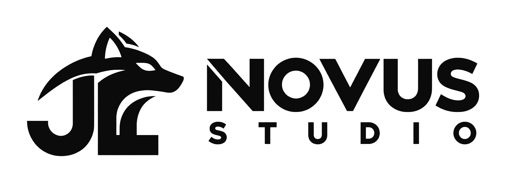
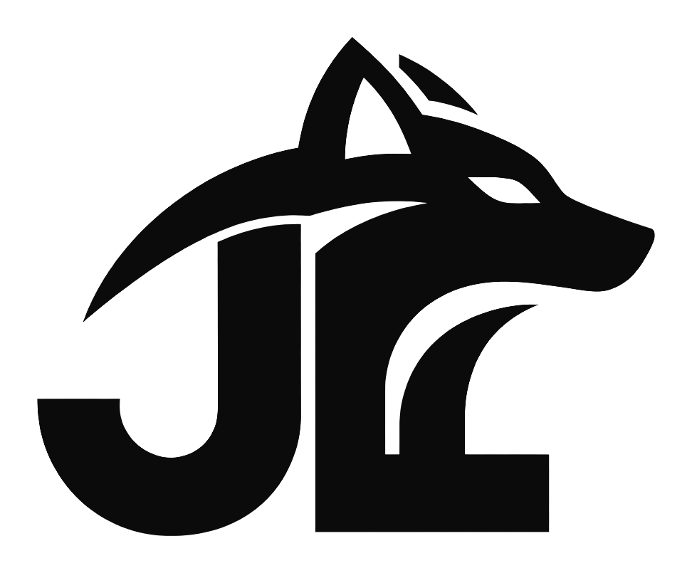

[index.html](https://github.com/user-attachments/files/35528692/index.html)
<!doctype html>
<html lang="es" data-theme="light">
<head>
<meta charset="utf-8">
<meta name="viewport" content="width=device-width, initial-scale=1">
<title>Novus Studio — Estudio Creativo Digital</title>
<meta name="description" content="Marketing digital, branding y desarrollo web para marcas que quieren verse y crecer como líderes.">
<meta property="og:title" content="Novus Studio — Estudio Creativo Digital">
<meta property="og:description" content="Marketing digital, branding y desarrollo web.">
<meta property="og:image" content="assets/og-image.jpg">
<meta property="og:type" content="website">
<meta property="og:locale" content="es_PE">
<meta name="robots" content="index, follow">

<link rel="icon" type="image/png" href="assets/favicon-32.png">
<link rel="apple-touch-icon" href="assets/apple-touch-icon-180.png">
<link rel="preconnect" href="https://fonts.googleapis.com">
<link rel="preconnect" href="https://fonts.gstatic.com" crossorigin>
<link href="https://fonts.googleapis.com/css2?family=Montserrat:wght@400;500;600;700;800&display=swap" rel="stylesheet">

</head>
<body>
<header id="top" class="dz">
  <nav class="dock" aria-label="Principal">
    
    

      <a class="on" href="#inicio">Inicio</a><a href="#servicios">Servicios</a><a href="#proyectos">Proyectos</a><a href="#nosotros">Nosotros</a><a href="#contacto">Contacto</a>
    

    

      <button class="toggle" id="toggle" aria-label="Cambiar modo claro u oscuro">
        <svg class="moon" viewBox="0 0 24 24" fill="none" stroke="currentColor" stroke-width="1.6"><path d="M21 12.8A9 9 0 1 1 11.2 3a7 7 0 0 0 9.8 9.8z"/></svg>
        <svg class="sun" viewBox="0 0 24 24" fill="none" stroke="currentColor" stroke-width="1.6" stroke-linecap="round"><circle cx="12" cy="12" r="4.2"/><path d="M12 2.5v2M12 19.5v2M2.5 12h2M19.5 12h2M5.3 5.3l1.4 1.4M17.3 17.3l1.4 1.4M5.3 18.7l1.4-1.4M17.3 6.7l1.4-1.4"/></svg>
      </button>
      <a class="cta solid" href="https://wa.me/51938437193" target="_blank" rel="noopener noreferrer" data-quote>Cotiza tu proyecto ↗</a>
    

  </nav>
</header>

<section class="hero dz" id="inicio">
  

    <video id="heroVideo" autoplay muted loop playsinline preload="auto" poster="assets/novus-hero-poster.jpg">
      <source src="novus-hero-web.mp4" type="video/mp4">
    </video>
  

  

    

      

        
Estudio creativo digital

        <h1>Diseñamos marcas que venden como líderes</h1>
        
Marketing digital, branding y desarrollo web para negocios que quieren proyectar una imagen premium y crecer con estrategia.

        

          <a class="btn" href="#servicios">Nuestros servicios →</a>
          <a class="play" href="#proyectos"><i></i>Ver portafolio</a>
        

        

          
<b>360°</b><small>Marketing integral</small>

          
<b>100%</b><small>Diseño a medida</small>

          

            <svg viewBox="0 0 32 32"><path d="M16 4 29 10 16 16 3 10z"/><path d="M3 16l13 6 13-6"/><path d="M3 22l13 6 13-6"/></svg>
            
Branding, web y marketing en un solo estudio.

          

        

      

    

  

</section>

<!-- SERVICIOS -->
<section class="block" id="servicios">
  

    

      

Servicios
<h2>Todo lo que tu marca necesita para crecer</h2>

      
Unimos estrategia, diseño y tecnología para que tu negocio se vea profesional y atraiga a los clientes correctos.

    

    

      <article class="card rv">
        
<svg viewBox="0 0 32 32"><rect x="4" y="6" width="24" height="16" rx="2"/><path d="M16 22v4M11 26h10"/></svg>

        <h3>Marketing Digital</h3>
        
Estrategias y campañas que convierten seguidores en clientes, con contenido que refleja la calidad de tu marca.

        <ul><li>Gestión de redes sociales</li><li>Publicidad en Meta y Google</li><li>Contenido y fotografía</li><li>Reportes de resultados</li></ul>
      </article>
      <article class="card rv">
        
<svg viewBox="0 0 32 32"><path d="M16 4 29 10 16 16 3 10z"/><path d="M3 16l13 6 13-6"/><path d="M3 22l13 6 13-6"/></svg>

        <h3>Branding</h3>
        
Identidades visuales sólidas y memorables que transmiten confianza desde el primer vistazo.

        <ul><li>Logotipo e identidad visual</li><li>Manual de marca</li><li>Papelería y aplicaciones</li><li>Kit para redes sociales</li></ul>
      </article>
      <article class="card rv">
        
<svg viewBox="0 0 32 32"><path d="M11 9 4 16l7 7M21 9l7 7-7 7M18 6l-4 20"/></svg>

        <h3>Desarrollo Web</h3>
        
Sitios rápidos, elegantes y optimizados para celular, pensados para vender y posicionarse en Google.

        <ul><li>Páginas web corporativas</li><li>Landing pages</li><li>Tiendas online</li><li>SEO y mantenimiento</li></ul>
      </article>
    

  

</section>

<!-- PROCESO -->
<section class="block process" id="proceso">
  

    

      

Proceso
<h2>Un método claro, de la idea al resultado</h2>

      
Trabajamos por etapas para que siempre sepas en qué punto está tu proyecto.

    

    

      

01
<h3>Descubrimiento</h3>
Conocemos tu negocio, tu público y tus objetivos.

      

02
<h3>Estrategia</h3>
Definimos el camino: mensaje, estilo y canales.

      

03
<h3>Diseño y desarrollo</h3>
Creamos tu marca, tu web o tus campañas con atención al detalle.

      

04
<h3>Lanzamiento</h3>
Publicamos, medimos y optimizamos para que sigas creciendo.

    

  

</section>

<!-- PROYECTOS -->
<section class="block" id="proyectos">
  

    

      

Proyectos
<h2>Trabajo con detalle en cada pieza</h2>

      
Una muestra de lo que creamos para nuestros clientes.

    

    

      <a class="proj rv" href="#contacto">
        
<svg class="lines" viewBox="0 0 400 250" preserveAspectRatio="none"></svg>
          

        

Branding<h3>Identidad de marca</h3>
<i>↗</i>

      </a>
      <a class="proj rv" href="#contacto">
        
<svg class="lines" viewBox="0 0 400 250" preserveAspectRatio="none"></svg>
          

<b></b><b></b><b></b>

        

Desarrollo web<h3>Sitio web corporativo</h3>
<i>↗</i>

      </a>
      <a class="proj rv" href="#contacto">
        
<svg class="lines" viewBox="0 0 400 250" preserveAspectRatio="none"></svg>
          

        

Marketing digital<h3>Campaña en redes</h3>
<i>↗</i>

      </a>
      <a class="proj rv" href="#contacto">
        
<svg class="lines" viewBox="0 0 400 250" preserveAspectRatio="none"></svg>
          

        

E-commerce<h3>Tienda online</h3>
<i>↗</i>

      </a>
    

  

</section>

<!-- NOSOTROS -->
<section class="block process" id="nosotros">
  

    

    

      
Nosotros

      <h2>Un estudio pequeño, con estándares de marca grande</h2>
      
En Novus Studio creemos que una marca bien construida abre puertas. Por eso cuidamos cada detalle: desde la estrategia hasta el último píxel, para que tu negocio se vea y se sienta premium.

      

        
<b>01</b>
<h4>Estrategia primero</h4>Cada decisión de diseño responde a un objetivo de negocio.

        
<b>02</b>
<h4>Diseño con intención</h4>Limpio, elegante y coherente en todos tus canales.

        
<b>03</b>
<h4>Trato cercano</h4>Comunicación directa y acompañamiento en todo el proceso.

      

    

  

</section>

<!-- CONFIANZA -->
<section class="block" id="clientes">
  

    

      

Confianza
<h2>Marcas y proyectos que confían en nosotros</h2>

      
Negocios reales que ya venden con una presencia digital a la altura de su calidad.

    

    <article class="case rv">
      <a class="case-shot" href="https://polleria-donde-hernan.github.io/" target="_blank" rel="noopener noreferrer" aria-label="Abrir la web de Pollería &amp; Parrillas Donde Hernan">
        

          
<b></b><b></b><b></b><em>polleria-donde-hernan.github.io</em>

          
        

      </a>
      

        <i></i>Caso real · En vivo
        
Pollería &amp; Parrillas “Donde Hernan” · Cajamarca

        <h3>Experiencia Web Cinematográfica &amp; Carta Digital Interactiva con Pedidos por WhatsApp</h3>
        
Una web inmersiva que transmite el sabor de la brasa desde el primer segundo y convierte visitas en pedidos directos.

        <ul class="deliv">
          <li>Web cinematográfica con animaciones al deslizar</li>
          <li>Carta digital interactiva por categorías</li>
          <li>Pedidos armados y enviados por WhatsApp</li>
          <li>Optimizada para celular</li>
        </ul>
        <a class="btn" href="https://polleria-donde-hernan.github.io/" target="_blank" rel="noopener noreferrer">Ver proyecto en vivo ↗</a>
      

    </article>
    

      

<svg viewBox="0 0 32 32"><path d="M8 4v10a3 3 0 0 0 6 0V4M11 4v24M22 28V4c-3 2-4 6-4 10h4"/></svg>

<h4>Gastronomía</h4>
Restaurantes, pollerías y cafeterías con carta digital y pedidos.

      

<svg viewBox="0 0 32 32"><path d="M5 11h22l-2 15H7z"/><path d="M11 11V8a5 5 0 0 1 10 0v3"/></svg>

<h4>Comercio</h4>
Tiendas y emprendimientos que venden mejor en redes y en web.

      

<svg viewBox="0 0 32 32"><rect x="4" y="10" width="24" height="16" rx="3"/><path d="M12 10V7a2 2 0 0 1 2-2h4a2 2 0 0 1 2 2v3M4 17h24"/></svg>

<h4>Servicios Profesionales</h4>
Consultorios, estudios y profesionales que necesitan transmitir confianza.

    

  

</section>

<!-- CTA -->
<section class="block" style="padding-bottom:0">
  

    

      <svg viewBox="0 0 1200 420" preserveAspectRatio="none" id="bandwaves" aria-hidden="true"></svg>
      
Hablemos

      <h2>¿Listo para que tu marca se vea premium?</h2>
      
Cuéntanos tu idea y te enviamos una propuesta a medida.

      <a class="btn" href="https://wa.me/51938437193" target="_blank" rel="noopener noreferrer" data-quote>Cotiza tu proyecto ↗</a>
    

  

</section>

<!-- CONTACTO -->
<section class="block" id="contacto">
  

    

      
Contacto

      <h2>Empecemos tu proyecto</h2>
      
Completa el formulario y te respondemos lo antes posible.

      

        <a href="https://wa.me/51938437193" target="_blank" rel="noopener" id="waLink"><small>WhatsApp</small>+51 938 437 193</a>
        <a href="mailto:7.jhuliniolopez@gmail.com" id="mailLink"><small>Email</small>7.jhuliniolopez@gmail.com</a>
        <a href="https://www.instagram.com/jlnovusstudio" target="_blank" rel="noopener noreferrer"><small><svg viewBox="0 0 24 24" aria-hidden="true"><rect x="3" y="3" width="18" height="18" rx="5"/><circle cx="12" cy="12" r="4"/><circle cx="17.3" cy="6.7" r=".9" fill="currentColor" stroke="none"/></svg>Instagram</small>@jlnovusstudio</a>
        <a href="https://www.facebook.com/share/1CuWkR24iw/" target="_blank" rel="noopener noreferrer"><small><svg viewBox="0 0 24 24" aria-hidden="true"><path d="M14.5 21v-7.5h2.6l.4-3.2h-3V8.4c0-.9.3-1.6 1.6-1.6h1.6V4c-.3 0-1.2-.1-2.3-.1-2.3 0-3.9 1.4-3.9 4v2.4H8.9v3.2h2.6V21"/></svg>Facebook</small>JL Novus Studio</a>
        <a href="https://www.linkedin.com/in/nilson-jhulinio-lopez-verastegui-5a494a190?utm_source=share_via&amp;utm_content=profile&amp;utm_medium=member_android" target="_blank" rel="noopener noreferrer"><small><svg viewBox="0 0 24 24" aria-hidden="true"><rect x="3" y="3" width="18" height="18" rx="4"/><path d="M7.8 10.5v6M7.8 7.6v.1M11.3 16.5v-6M11.3 13.4c0-1.8 1-2.9 2.5-2.9s2.4 1 2.4 2.9v3.1"/></svg>LinkedIn</small>Nilson Jhulinio Lopez Verastegui</a>
        
<small>Ubicación</small>Cajamarca, Perú

        
<small>Horario</small>Lunes a sábado, 9:00 a. m. – 7:00 p. m.

      

    

    <form class="rv" id="form">
      
<label for="f-name">Nombre</label><input id="f-name" required>

      
<label for="f-mail">Email</label><input id="f-mail" type="email" required>

      
<label for="f-phone">WhatsApp</label><input id="f-phone" type="tel">

      
<label for="f-svc">Servicio</label><select id="f-svc"><option>Marketing Digital</option><option>Branding</option><option>Desarrollo Web</option><option>Paquete completo</option></select>

      
<label for="f-msg">Cuéntanos tu proyecto</label><textarea id="f-msg"></textarea>

      <button class="btn full" type="submit">Enviar mensaje →</button>
      

    </form>
  

</section>

<footer>
  

    

      

        
        
Estudio creativo digital. Marketing digital, branding y desarrollo web para marcas que quieren destacar.

        

          <a href="https://www.instagram.com/jlnovusstudio" target="_blank" rel="noopener noreferrer" aria-label="Instagram @jlnovusstudio"><svg viewBox="0 0 24 24"><rect x="3" y="3" width="18" height="18" rx="5"/><circle cx="12" cy="12" r="4"/><circle cx="17.3" cy="6.7" r=".9" fill="currentColor" stroke="none"/></svg></a>
          <a href="https://www.facebook.com/share/1CuWkR24iw/" target="_blank" rel="noopener noreferrer" aria-label="Facebook JL Novus Studio"><svg viewBox="0 0 24 24"><path d="M14.5 21v-7.5h2.6l.4-3.2h-3V8.4c0-.9.3-1.6 1.6-1.6h1.6V4c-.3 0-1.2-.1-2.3-.1-2.3 0-3.9 1.4-3.9 4v2.4H8.9v3.2h2.6V21"/></svg></a>
          <a href="https://www.linkedin.com/in/nilson-jhulinio-lopez-verastegui-5a494a190?utm_source=share_via&amp;utm_content=profile&amp;utm_medium=member_android" target="_blank" rel="noopener noreferrer" aria-label="LinkedIn Nilson Jhulinio Lopez Verastegui"><svg viewBox="0 0 24 24"><rect x="3" y="3" width="18" height="18" rx="4"/><path d="M7.8 10.5v6M7.8 7.6v.1M11.3 16.5v-6M11.3 13.4c0-1.8 1-2.9 2.5-2.9s2.4 1 2.4 2.9v3.1"/></svg></a>
        

      

      
<h5>Navegación</h5><a href="#inicio">Inicio</a><a href="#servicios">Servicios</a><a href="#proyectos">Proyectos</a><a href="#nosotros">Nosotros</a><a href="#contacto">Contacto</a>

      
<h5>Servicios</h5><a href="#servicios">Marketing Digital</a><a href="#servicios">Branding</a><a href="#servicios">Desarrollo Web</a><a href="#servicios">Tiendas online</a>

      
<h5>Contacto</h5><a href="https://wa.me/51938437193" target="_blank" rel="noopener noreferrer" data-quote>Cotiza tu proyecto ↗</a><a href="https://wa.me/51938437193" target="_blank" rel="noopener noreferrer" id="waFoot">+51 938 437 193</a><a href="mailto:7.jhuliniolopez@gmail.com" id="mailFoot">7.jhuliniolopez@gmail.com</a><a href="https://www.instagram.com/jlnovusstudio" target="_blank" rel="noopener noreferrer">Instagram · @jlnovusstudio</a><a href="https://www.facebook.com/share/1CuWkR24iw/" target="_blank" rel="noopener noreferrer">Facebook · JL Novus Studio</a><a href="https://www.linkedin.com/in/nilson-jhulinio-lopez-verastegui-5a494a190?utm_source=share_via&amp;utm_content=profile&amp;utm_medium=member_android" target="_blank" rel="noopener noreferrer">LinkedIn · Nilson Lopez V.</a>Cajamarca, Perú Lun – Sáb · 9:00 a. m. – 7:00 p. m.

    

    
© 2026 Novus Studio. Todos los derechos reservados.Estudio creativo digital

  

</footer>

<!-- MODAL DE COTIZACIÓN -->
<dialog class="quote" id="quote" aria-labelledby="q-title">
  <form class="q-in" id="qform" method="dialog" novalidate>
    

      

        
Cotización rápida

        <h3 id="q-title">Arma tu proyecto en 1 minuto</h3>
        
Elige lo que necesitas y te enviamos una propuesta a medida por WhatsApp.

      

      <button type="button" class="q-x" id="qclose" aria-label="Cerrar">×</button>
    

    <fieldset class="pills-wrap" style="border:0">
      <legend class="q-label">¿Qué necesitas? <em>(puedes elegir varios)</em></legend>
      

        <label class="pill"><input type="checkbox" name="svc" value="Página Web / Landing Cinematográfica">Página Web / Landing Cinematográfica</label>
        <label class="pill"><input type="checkbox" name="svc" value="Sistema Web / Software a Medida">Sistema Web / Software a Medida</label>
        <label class="pill"><input type="checkbox" name="svc" value="Branding & Identidad Visual">Branding &amp; Identidad Visual</label>
        <label class="pill"><input type="checkbox" name="svc" value="Marketing Digital & Contenido">Marketing Digital &amp; Contenido</label>
        <label class="pill"><input type="checkbox" name="svc" value="Otro proyecto">Otro proyecto</label>
      

    </fieldset>
    

      
<label class="q-label" for="q-name">Nombre o empresa</label><input id="q-name" autocomplete="organization" placeholder="Tu nombre o el de tu negocio">

      
<label class="q-label" for="q-budget">Presupuesto <em>(opcional)</em></label>
        <select id="q-budget">
          <option value="">Prefiero conversarlo</option>
          <option>Menos de S/ 1,000</option>
          <option>S/ 1,000 – S/ 3,000</option>
          <option>S/ 3,000 – S/ 6,000</option>
          <option>Más de S/ 6,000</option>
        </select>
      

    

    
<label class="q-label" for="q-idea">Cuéntanos tu idea</label><textarea id="q-idea" placeholder="¿Qué te gustaría lograr? Fechas, referencias, lo que tengas en mente."></textarea>

    

    

      <small>Se abrirá WhatsApp con tu mensaje listo. Solo tienes que enviarlo.</small>
      <button class="btn" type="submit"><svg viewBox="0 0 24 24" aria-hidden="true"><use href="#ico-wa"/></svg>Enviar cotización por WhatsApp</button>
    

  </form>
</dialog>

<!-- BOTÓN FLOTANTE WHATSAPP -->
<a class="wa-fab" href="https://wa.me/51938437193" target="_blank" rel="noopener noreferrer" aria-label="Escríbenos por WhatsApp">
  <svg viewBox="0 0 24 24" aria-hidden="true"><use href="#ico-wa"/></svg>
</a>
<svg width="0" height="0" style="position:absolute" aria-hidden="true">
  <symbol id="ico-wa" viewBox="0 0 24 24"><path d="M17.47 14.38c-.3-.15-1.76-.87-2.03-.97-.27-.1-.47-.15-.67.15-.2.3-.77.97-.94 1.16-.17.2-.35.22-.64.07-.3-.15-1.26-.46-2.39-1.47-.88-.79-1.48-1.76-1.65-2.06-.17-.3-.02-.46.13-.6.13-.14.3-.35.44-.52.15-.18.2-.3.3-.5.1-.2.05-.37-.02-.52-.08-.15-.67-1.61-.92-2.2-.24-.58-.49-.5-.67-.51h-.57c-.2 0-.52.07-.79.37-.27.3-1.04 1.02-1.04 2.48s1.06 2.88 1.21 3.07c.15.2 2.1 3.2 5.08 4.49.71.31 1.26.49 1.7.63.71.22 1.36.19 1.87.12.57-.09 1.76-.72 2-1.42.25-.69.25-1.29.18-1.41-.08-.13-.28-.2-.57-.35m-5.42 7.4h-.01a9.87 9.87 0 0 1-5.03-1.38l-.36-.21-3.74.98 1-3.65-.24-.37a9.86 9.86 0 0 1-1.51-5.26c0-5.45 4.44-9.88 9.89-9.88 2.64 0 5.12 1.03 6.99 2.9a9.82 9.82 0 0 1 2.89 6.99c0 5.45-4.44 9.88-9.88 9.88m8.41-18.3A11.82 11.82 0 0 0 12.05 0C5.5 0 .16 5.34.16 11.89c0 2.1.55 4.14 1.59 5.95L.06 24l6.3-1.65a11.88 11.88 0 0 0 5.68 1.45h.01c6.55 0 11.89-5.34 11.89-11.89a11.82 11.82 0 0 0-3.48-8.41z"/></symbol>
</svg>

</body>
</html>
